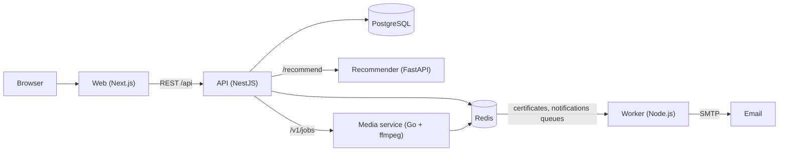

<div align="center">

# LearnSphere

**A modern learning platform for publishing courses, tracking progress and certifying achievement.**

[](https://github.com/your-org/LearnSphere/actions/workflows/ci.yml)
[](LICENSE)
[](https://www.typescriptlang.org/)
[](https://go.dev/)
[](https://www.python.org/)
[](https://www.prisma.io/)
[](https://nodejs.org/)

</div>

---

## Overview

Online learning teams usually stitch together a video host, a quiz tool, a forum and a certificate generator. LearnSphere brings these into one platform: instructors publish structured courses (modules, lessons, quizzes), learners enroll and track progress, discuss in per-course forums, receive personalised recommendations, and earn verifiable certificates on completion.

The system is a monorepo of focused components: a Next.js web app, a NestJS API backed by PostgreSQL and Redis, a Python recommendation service, a Go media transcoding service, and a background worker.

## Key features

- **Course catalogue** with categories, tags, levels, reviews and instructor profiles.
- **Structured curriculum**: courses contain modules, lessons and quizzes.
- **Enrollment and progress tracking**, with debounced client-side writes and idempotent server-side upserts.
- **Server-side quiz grading**: correct options never leave the API.
- **Verifiable certificates** issued on completion and rendered asynchronously by the worker.
- **Course forums** with threads, posts and up/down voting.
- **Hybrid recommendations** from a dedicated Python service, with a popular-courses fallback in the API.
- **Video transcoding** to HLS renditions via ffmpeg in the Go media service.
- **Notifications** delivered by email through the worker.
- **Role-based access** for students, instructors and admins.
- **Offline support** through a service worker and offline page in the web app.

## Architecture



Request flow:

1. The Next.js app renders catalogue pages on the server and calls the NestJS API (all routes are under the `/api` prefix).
2. The API reads and writes PostgreSQL through Prisma and uses Redis for caching and job queues.
3. When a learner finishes the last lesson, the API enqueues a `certificates` job; the worker renders the certificate and emails the learner. Failed jobs are moved to a `<queue>:dead` list.
4. Recommendations come from the Python service; if it is unavailable the API falls back to popular courses.
5. Instructor video uploads are transcoded to HLS renditions by the Go media service.

See [docs/architecture.md](docs/architecture.md) for more detail.

## Tech stack

| Layer | Technology |
| --- | --- |
| Web | Next.js 14, React 18, SWR |
| API | NestJS 10, Prisma 5, zod validation, JWT (`@nestjs/jwt`) |
| Recommender | Python 3.12, FastAPI |
| Media service | Go 1.22, ffmpeg |
| Worker | Node.js, ioredis, nodemailer |
| Data | PostgreSQL 16, Redis 7 |
| Shared code | `@learnsphere/shared-types` (zod schemas), `@learnsphere/ui` (React components) |
| Tooling | npm workspaces, ESLint, Jest, Vitest, pytest, `go test`, Docker Compose, GitHub Actions |

## Repository structure

```
LearnSphere/
├── apps/
│   ├── api/                 # NestJS REST API
│   ├── web/                 # Next.js web app
│   └── worker/              # Redis queue worker (certificates, notifications)
├── packages/
│   ├── shared-types/        # Shared zod schemas and types
│   └── ui/                  # Shared React components
├── services/
│   ├── recommender/         # Python FastAPI recommendation service
│   └── media-service/       # Go video transcoding service
├── prisma/                  # schema.prisma, migrations, seed script
├── deploy/                  # Dockerfiles, docker-compose.yml, nginx.conf
├── docs/                    # API, architecture, data model, deployment
├── scripts/                 # Dev runner and helper scripts
├── .github/workflows/       # CI, CodeQL, release, stale
├── Makefile
└── .env.example
```

## Getting started

### Prerequisites

- Node.js 20 and npm
- Python 3.12 (3.11+ supported)
- Go 1.22
- Docker and Docker Compose
- ffmpeg (for local runs of the media service)

### 1. Clone and install

```bash
git clone https://github.com/your-org/LearnSphere.git
cd LearnSphere
make install        # npm install, Python requirements, Go modules
```

### 2. Configure the environment

```bash
cp .env.example .env
```

Set at least a strong `JWT_SECRET`. The template defines `DATABASE_URL`, `REDIS_URL`, `JWT_SECRET`, `JWT_EXPIRES_IN`, `NEXT_PUBLIC_API_URL`, `RECOMMENDER_URL`, `MEDIA_SERVICE_URL`, `SMTP_HOST`, `SMTP_PORT` and `S3_BUCKET`.

### 3. Start infrastructure, migrate and seed

```bash
make db-up          # PostgreSQL 16 and Redis 7 via Docker Compose
make db-migrate     # npx prisma migrate deploy
make db-seed        # npx prisma db seed
```

### 4. Run the services

Run the full stack in containers:

```bash
make docker-up      # builds and starts postgres, redis, api, web, worker, recommender, media-service
```

Or run locally:

```bash
make dev            # API (:4000), web (:3000) and worker together
```

```bash
# Recommender (:8000)
cd services/recommender && uvicorn app.main:app --port 8000

# Media service (:8080)
cd services/media-service && go run ./cmd/server
```

| Service | URL |
| --- | --- |
| Web | http://localhost:3000 |
| API | http://localhost:4000/api |
| Recommender | http://localhost:8000 (`/health`) |
| Media service | http://localhost:8080 (`/healthz`, `/readyz`) |

### Makefile targets

`install`, `dev`, `build`, `test`, `lint`, `db-up`, `db-migrate`, `db-seed`, `docker-up`.

## API overview

All routes are served under the `/api` prefix. Full reference: [docs/api.md](docs/api.md).

| Resource | Method and path | Description |
| --- | --- | --- |
| Auth | `POST /auth/register` | Create an account |
| Auth | `POST /auth/login` | Obtain a JWT |
| Courses | `GET /courses` | List courses |
| Courses | `GET /courses/:slug` | Course detail |
| Courses | `POST /courses` | Create a course (instructor or admin) |
| Lessons | `GET /lessons/:id` | Fetch a lesson |
| Lessons | `GET /lessons/:id/next` | Next lesson in the course |
| Quizzes | `GET /quizzes/:id` | Fetch a quiz |
| Quizzes | `POST /quizzes/:id/attempts` | Submit an attempt (graded server-side) |
| Enrollments | `GET /enrollments/me` | Current user's enrollments |
| Enrollments | `POST /enrollments/:courseId` | Enroll in a course |
| Enrollments | `DELETE /enrollments/:courseId` | Unenroll |
| Progress | `GET /progress/courses/:courseId` | Course progress |
| Progress | `PUT /progress/lessons/:lessonId` | Record lesson progress |
| Certificates | `POST /certificates/:courseId` | Request a certificate |
| Certificates | `GET /certificates/verify/:code` | Verify a certificate |
| Forum | `GET /forum/courses/:courseId/threads` | List threads |
| Forum | `POST /forum/courses/:courseId/threads` | Create a thread |
| Forum | `GET /forum/threads/:id/posts` | List posts |
| Forum | `POST /forum/threads/:id/posts` | Reply to a thread |
| Forum | `POST /forum/posts/:id/vote` | Vote on a post |
| Recommendations | `GET /recommendations` | Personalised course suggestions |

Supporting services:

| Service | Endpoints |
| --- | --- |
| Recommender | `GET /health`, `POST /recommend`, `POST /analyze` |
| Media service | `/v1/jobs`, `/healthz`, `/readyz` |

## Data model

Defined in [prisma/schema.prisma](prisma/schema.prisma); see [docs/data-model.md](docs/data-model.md).

- **Identity**: `User` (roles `STUDENT`, `INSTRUCTOR`, `ADMIN`), `InstructorProfile`
- **Catalogue**: `Category`, `Tag`, `Course`, `CourseTag`, `Review`
- **Curriculum**: `Module`, `Lesson`, `Quiz`, `Question`, `Option`
- **Learning activity**: `Enrollment`, `LessonProgress`, `QuizAttempt`, `Certificate`
- **Community**: `ForumThread`, `ForumPost`, `PostVote`
- **Messaging**: `Notification`

## Testing

```bash
make test           # workspace tests, pytest, go test ./...
make lint           # ESLint
```

| Component | Runner |
| --- | --- |
| API | Jest |
| Web | Vitest |
| Worker | `node --test` |
| Recommender | pytest |
| Media service | `go test` |

CI ([.github/workflows/ci.yml](.github/workflows/ci.yml)) runs lint and tests for Node 20, Python 3.12 and Go 1.22 on every push to `main` and every pull request. CodeQL analysis runs in a separate workflow.

## Deployment

- Dockerfiles for the API, web app and worker live in [deploy/](deploy/); the recommender and media service ship their own Dockerfiles.
- `deploy/docker-compose.yml` defines the full stack; `deploy/nginx.conf` provides reverse-proxy routing.
- Run `npx prisma migrate deploy` against the production database before starting the API.
- Terminate TLS at the load balancer. The `worker` and `media-service` consume from Redis-backed queues and scale horizontally.
- Provide secrets through your orchestrator; never commit a real `.env`.

Details: [docs/deployment.md](docs/deployment.md).

## Security

- Authentication uses short-lived JWTs (`JWT_EXPIRES_IN`, default `15m`); sensitive routes are protected by a JWT guard and role guard.
- Request bodies are validated with shared zod schemas.
- Quiz answers are graded on the server; correct options are never sent to clients.
- Secrets are supplied via environment variables; `.env` is git-ignored.
- CodeQL scanning and Dependabot are enabled.

To report a vulnerability, follow [SECURITY.md](SECURITY.md).

## Roadmap

- Instructor analytics dashboard
- Live cohort sessions
- Learning paths spanning multiple courses
- Additional notification channels

## Contributing

Contributions are welcome. Please read [CONTRIBUTING.md](CONTRIBUTING.md) and the [Code of Conduct](CODE_OF_CONDUCT.md) before opening a pull request. Changes are tracked in [CHANGELOG.md](CHANGELOG.md).

## License

Released under the [MIT License](LICENSE).
